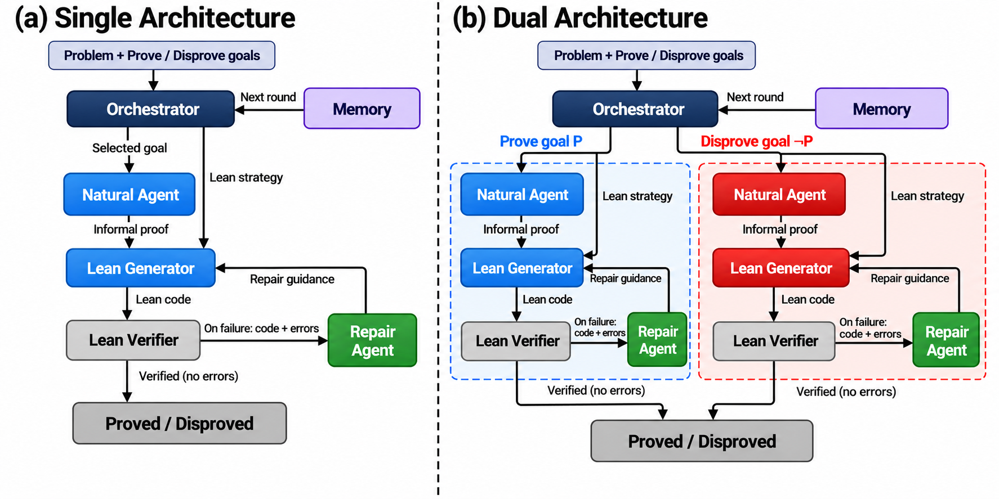
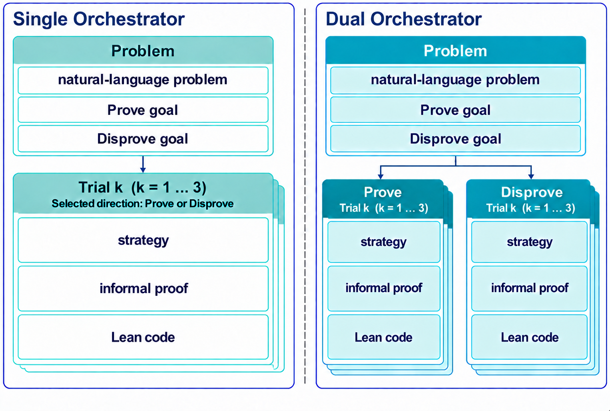

# Single & Dual · LLM–Lean

**수학 문제 자동 해결을 위한 LLM-Lean 접근과 아키텍처 제안**

대규모 언어 모델(LLM)이 생성한 증명을 Lean으로 검증하는 자동 정리 증명(ATP) 연구입니다.
명제의 참·거짓이 주어지지 않은 **Prove or Disprove** 문제에서,
한 목표를 선택하는 **Single**과 두 목표를 병렬 탐색하는 **Dual**을 비교합니다.

**Keywords:** ATP · LLM · AI4Math · Lean

[최종 원고 HWP](paper/paper.hwp) · [논문 PDF](paper/paper.pdf) · [논문 소스](paper/paper.tex) ·
[재현 방법](REPRODUCIBILITY.md) · [데이터](data/book137_v1/README.md) ·
[에이전트 프롬프트](prompts/README.md)

## Single과 Dual의 구조



*그림 1. Single은 라운드마다 Prove 또는 Disprove 목표를 선택하고, Dual은 두 목표를 병렬로 탐색합니다.*

두 구조 모두 Orchestrator의 전략에 따라 자연어 증명과 Lean 코드를 생성합니다.
Lean 검증에 실패하면 Repair Agent의 피드백을 바탕으로 코드를 수정하고,
검증을 통과하면 Proved 또는 Disproved로 판정합니다.

<p align="center">
  <a href="paper/assets/figure2_memory.png">
    
  </a>
</p>

*그림 2. 문제와 목표, 시도별 전략·자연어 증명·Lean 코드를 저장하는 메모리 구성.*

첫 라운드는 이전 탐색 기록 없이 시작합니다. 해당 라운드의 모든 시도가 실패하면
탐색 기록을 저장하고, 2·3라운드에서 이를 참고하여 전략을 다시 수립합니다.

## 평가 문제

본 연구에서는 고등학교에서 대학교 수준의 수학 관련 서적 5권의 137개 문제를 분석 대상으로 사용하였다.

| 서적 | Prove | Disprove | 전체 |
|---|---:|---:|---:|
| Book of Proof | 24 | 31 | 55 |
| Basic Analysis I | 2 | 11 | 13 |
| Linear Algebra Done Right | 6 | 20 | 26 |
| Exercises and Problems in Calculus | 8 | 13 | 21 |
| Abstract Algebra: Theory and Applications | 22 | 0 | 22 |
| **합계** | **62** | **75** | **137** |

## 전체 해결 결과 · 표 4

| Architecture | Proved | Disproved | Unsolved | Pass@5 (%) | Accuracy@5 (%) |
|---|---:|---:|---:|---:|---:|
| Single | 50 | 56 | 31 | 77.37 | 62.77 |
| Dual | 52 | 57 | 28 | 79.56 | 65.55 |

- **Pass@5**: 5회 중 한 번이라도 해결한 문제 수 / 137 × 100. Single은 106개, Dual은 109개를 해결했습니다.
- **Accuracy@5**: 본 논문에서 정의한 5회 평균 정확도. 전체 정답 실행 수 / (137 × 5) × 100이며, Single은 430/685, Dual은 449/685입니다.
- **Proved / Disproved / Unsolved**: Pass@5 기준으로 집계한 문제 수입니다.

두 구조가 공통으로 해결한 문제는 106개이고, Dual만 해결한 문제는 3개입니다.
Pass@5의 차이는 통계적으로 유의하지 않았습니다(양측 정확 McNemar 검정, **p = 0.25**).

## 코드 길이별 해결 결과 · 표 5

| Group | 문제 수 | Single Pass@5 | Single Length ratio | Dual Pass@5 | Dual Length ratio |
|---|---:|---:|---:|---:|---:|
| Short | 46 | 44/46 | 4.91 | 44/46 | 4.75 |
| Medium | 46 | 36/46 | 2.30 | 37/46 | 2.08 |
| Long | 45 | 26/45 | 1.48 | 28/45 | 1.32 |
| **Overall** | **137** | **106/137** | **3.18** | **109/137** | **2.96** |

정답 Lean 코드의 줄 수를 오름차순으로 정렬하여 Short 46개, Medium 46개,
Long 45개로 나누었습니다. 길이가 같으면 문제 ID순으로 정렬합니다.

**Length ratio = 생성 증명 코드 줄 수 / 해당 문제의 정답 증명 코드 줄 수**

빈 줄과 주석을 제외한 줄 수를 사용합니다. 각 문제의 5회 실행 중 정해진 실행 순서상
**첫 성공 코드**로 비율을 계산하고, 각 구조가 해결한 문제들의 비율을 산술평균합니다.
따라서 3.18은 정답 코드 대비 평균 3.18배 길이임을 뜻합니다.

모든 길이 구간에서 Dual의 평균 길이 배수가 더 낮았습니다.
평균에 포함되는 성공 문제는 구조별로 다를 수 있습니다.

## 라운드별 해결 결과 · 표 6

| Architecture | Round 1 해결 | Round 2 추가 해결 | Round 3 추가 해결 | 총 해결 |
|---|---:|---:|---:|---:|
| Single | 66 | 30 | 10 | 106 |
| Dual | 77 | 25 | 7 | 109 |

각 문제의 5회 반복 실행 중 **처음 성공한 실행**을 선택하고,
그 실행에서 해결된 라운드를 집계했습니다. 5회 실행의 평균이나 가장 빠른 해결 라운드가 아닙니다.

Dual은 첫 라운드에서 77개, Single은 66개를 해결했습니다.
이전 탐색 기록을 활용한 2·3라운드에서는 Single이 40개, Dual이 32개를 추가로 해결했습니다.
이 집계는 라운드별 해결 분포를 보여주며, 메모리 자체의 효과를 분리하여 측정한 결과는 아닙니다.

## 토큰·시간·비용 · 표 7

| 실행당 평균 | Single | Dual |
|---|---:|---:|
| 입력 토큰 | 92,408 | 174,885 |
| 출력 토큰 | 14,989 | 25,137 |
| 전체 토큰 | 107,397 | 200,022 |
| 실행 시간 (초) | 395.4 | 485.6 |
| 기록된 API 비용 (USD) | 0.00873 | 0.01531 |

미해결 실행까지 포함한 구조별 685회 실행의 평균입니다.
Dual은 상대적으로 짧은 성공 코드를 생성했지만 토큰 사용량, 실행 시간 및 API 비용은 더 높았습니다.
일부 API 응답에는 사용량 정보가 누락되어 있어, 비용은 기록된 값 기준입니다.

## 최종 원고 재현에 필요한 파일

| 목적 | 파일 |
|---|---|
| 최종 원고와 사용 그림 | `paper/paper.hwp`, `paper/paper.tex`, `paper/paper.pdf`, `paper/assets/` |
| 모델 입력 | `data/book137_v1/problems.jsonl` |
| 평가 정답·참조 증명 | `data/book137_v1/labels.jsonl`, `reference_answers.jsonl` |
| 문제 목록·데이터 해시 | `data/book137_v1/ids.txt`, `manifest.json` |
| 실제 에이전트·Lean 검증 구현 | `src/single_orchestrator/` |
| 역할별 프롬프트 | `prompts/`, `src/single_orchestrator/goal_prompts.py` |
| 현재 실행 설정·의존성 | `configs/two_goal_experiment.env`, `pyproject.toml`, `requirements-tested.txt` |
| Lean 환경 설치·반복 실행 | `scripts/setup_minif2f.sh`, `scripts/run_logged_experiment.py` |
| 실행 결과 채점 | `scripts/analyze_logged_experiment.py` |
| 최종 결과 원자료·집계 | `results/final_paper/`, `scripts/reproduce_paper_tables.py` |
| 입력 경계·해시 검증 | `scripts/validate_release.py` |

평가 정답, 참조 증명 및 결과 원자료는 **모델 입력이 아닙니다**.
구현 설명은 [FINAL_PIPELINE.md](docs/FINAL_PIPELINE.md), 설치·실행은
[CURRENT_SETUP.md](docs/CURRENT_SETUP.md)를 참고하세요.

## 기존 결과 검산: 모델 호출 없음

```bash
python3 scripts/validate_release.py
python3 scripts/reproduce_paper_tables.py --check
```

두 번째 명령은 최종 표 1·4·5·6·7과 방향 선택 집계를 원자료에서 재계산하고,
성공 코드의 줄 수도 확인합니다. 과거 Lean 검증을 새로 실행하는 명령은 아닙니다.
새 모델 실행에는 명시적인 `--run`이 필요하며 기존 결과와 별도 디렉터리를 사용합니다.
